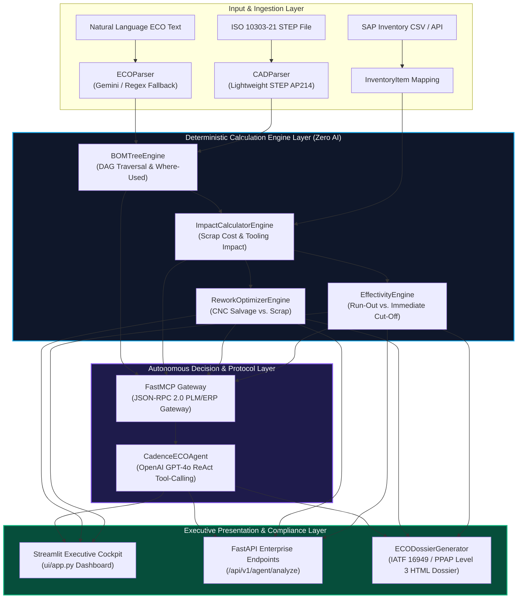

# CadencePLM — Autonomous Engineering Change Order (ECO) Intelligence Platform

<div align="center">

[](https://www.python.org/)
[](https://fastapi.tiangolo.com)
[](https://streamlit.io/)
[](https://modelcontextprotocol.io/)
[](https://www.aiag.org/)
[](https://www.docker.com/)
[-success.svg)](file:///c:/Users/HP/Desktop/rag&fine-tune%20projects/cadence_plm/tests)

**Deterministic BOM Traversal • Scrap vs. Rework Optimization • Effectivity Run-Out Planning • Live ReAct LLM Agent • ISO 10303-21 CAD Parser**

[English Documentation](#english-documentation) | [Türkçe Dokümantasyon](#türkçe-dokümantasyon)

</div>

---

# English Documentation

## 1. Executive Overview & Problem Statement

In Tier-1 automotive powertrain manufacturing, managing an **Engineering Change Order (ECO)** is one of the highest-friction, highest-risk operational workflows. A simple 0.02 mm tolerance reduction on a pinion gear or an alloy substitution on a primary shaft frequently triggers:
- **ERP & PLM Disconnection:** Siemens Teamcenter holds the CAD revision tree; SAP S/4HANA holds the physical warehouse inventory. Neither system natively answers: *"Can our 55 on-hand gears be salvaged on a CNC lathe for $20 each, or must we scrap $7,400 in stock and wait 30 days for new supplier tooling?"*
- **Scrap vs. Rework Blind Spots:** In the absence of automated trade-off analytics, machinable parts are prematurely written off as scrap, or non-machinable parts cause assembly line starvation.
- **Unscheduled Assembly Line Stoppage:** Automotive final assembly line downtime averages **~$1,200/minute**. Inaccurate effectivity dates (`Immediate Cut-Off` vs. `Use-Up Stock`) directly risk line starvation.
- **Audit Deficiencies:** Generating IATF 16949 Clause 8.5.6 (Control of Changes) and AIAG/VDA PPAP Level 3 documentation takes days of manual cross-departmental paperwork.

**CadencePLM** solves this by inserting a deterministic simulation, ReAct AI decision agent, and IATF 16949 dossier generation layer between your PLM and ERP systems—transforming a 4-day manual engineering investigation into a 5-millisecond autonomous calculation.

---

## 2. Strategic Product Command Kit & Reference Guides

To master the technical capabilities, architecture boundaries, and business sales collateral, consult our dedicated command documents:

| Document | Description | Key Focus |
| :--- | :--- | :--- |
| **[docs/CAPABILITIES_AND_BOUNDARIES.md](file:///c:/Users/HP/Desktop/rag&fine-tune%20projects/cadence_plm/docs/CAPABILITIES_AND_BOUNDARIES.md)** | **System Capabilities & Architectural Boundaries** | Explains exactly what CadencePLM can do (DAG traversal, rework math, effectivity decision tree, STEP parsing) and what it **CANNOT** do (LLM hallucination firewall, no 3D mesh collisions, read-only ERP safety, scaling limits). |
| **[docs/BUYER_PLAYBOOK.md](file:///c:/Users/HP/Desktop/rag&fine-tune%20projects/cadence_plm/docs/BUYER_PLAYBOOK.md)** | **Commercial Buyer Playbook & Battlecard** | Target ICPs (VP of Engineering, Plant Manager, Head of Procurement), concrete **ROI formula** ($60k annual license vs. $178k net annual savings), top 5 toughest customer objections with engineering answers, and 3 golden demo scripts. |
| **[scripts/verify_capabilities.py](file:///c:/Users/HP/Desktop/rag&fine-tune%20projects/cadence_plm/scripts/verify_capabilities.py)** | **Live 5-Step System Verification Script** | Standalone automated audit script testing text parsing, DAG Where-Used traversal, rework math, STEP parsing, and fail-safe error handling with an ANSI capability matrix. |

---

## 3. Core Architecture & Deterministic Separation Principle

CadencePLM strictly enforces the **Deterministic Separation Directive** ([`.antigravityrules §1`](file:///c:/Users/HP/Desktop/rag&fine-tune%20projects/cadence_plm/.antigravityrules)):

> **Critical Architectural Rule:** Scrap cost calculation, run-out days, BOM tree DAG traversal, and rework savings are **NEVER calculated by an LLM**. All numbers are generated by deterministic, zero-hallucination pure Python engines in [`src/engines/`](file:///c:/Users/HP/Desktop/rag&fine-tune%20projects/cadence_plm/src/engines). The LLM is restricted to natural language intent understanding and executive synthesis.



---

## 4. Key Capabilities Breakdown

### 4.1 Deterministic BOM Tree Traversal & Where-Used Analysis
- **Top-Down Impact:** Starting from any modified part, traverses down the tree to collect all impacted subassemblies and leaf parts.
- **Bottom-Up Where-Used:** Traces parent assemblies up to root level ($N$-levels). For example:
  $$\text{GB-PINION-02 (Leaf)} \longrightarrow \text{GBX-1300 (Level 1: Output Differential)} \longrightarrow \text{GBX-1000 (Level 2: Main Gearbox)}$$
- **Cycle Prevention:** Uses a strict `visited_parts` set; detects cyclic loops and immediately raises [`BOMStructureError`](file:///c:/Users/HP/Desktop/rag&fine-tune%20projects/cadence_plm/src/core/exceptions.py).

### 4.2 Scrap vs. Rework Optimization Engine
- **Gross Scrap Cost Formula:**
  $$\text{Scrap Cost} = \sum_{i \in \text{Impacted Parts}} (\text{Stock}_i \times \text{Unit Cost}_i)$$
- **Machinable Metal Rules:** Detects shafts, pinions, gears, bushings, and axles. If change type is `TOLERANCE` or `DIMENSION`:
  - `rework_cost_per_unit = round(unit_cost * 0.15, 2)` (15% CNC turning salvage cost)
  - `net_savings = round((unit_cost - rework_cost_per_unit) * stock_quantity, 2)`
- **Material Change Rule:** If change type is `MATERIAL` (e.g. 16MnCr5 to 42CrMo4 steel) or part is non-machinable (seals, bearings, circlips), salvage is impossible: `is_reworkable = False`, scrap is mandatory.

### 4.3 Effectivity & Stock Run-Out Planning
- **Stock Depletion Days:**
  $$\text{Run-Out Days} = \left\lceil \frac{\text{Stock Quantity}}{\text{Daily Consumption Rate}} \right\rceil \quad (\text{Default: 5 units/day})$$
- **Decision Logic:**
  - $\text{Run-Out Days} \le \text{Tooling Lead Time} \implies$ **`USE_UP_STOCK`** (Transition duration = run-out days, Scrap cost = $0.00).
  - $\text{Run-Out Days} > \text{Tooling Lead Time} \implies$ **`IMMEDIATE_CUTOFF`** (Immediate cutoff once new tooling arrives, remaining inventory scrapped).

### 4.4 Lightweight ISO 10303-21 STEP CAD Parser
- Pure Python ASCII parser without OpenCASCADE or C++ bindings.
- Reads `PRODUCT_DEFINITION`, `PRODUCT_DEFINITION_FORMATION`, and `NEXT_ASSEMBLY_USAGE_OCCURRENCE`.
- Aggregates multi-occurrence quantities and outputs native [`BOMItem`](file:///c:/Users/HP/Desktop/rag&fine-tune%20projects/cadence_plm/src/schemas/bom.py) objects directly.

### 4.5 IATF 16949 / PPAP Level 3 Compliant Dossier Generation
- Generates an executive, audit-ready HTML report ([`reports/ECO_IMPACT_REPORT_{eco_id}.html`](file:///c:/Users/HP/Desktop/rag&fine-tune%20projects/cadence_plm/reports)).
- Includes KPI trade-off cards, Where-Used flow diagrams, supplier tooling risk matrix, and a 3-way sign-off block: **R&D Director**, **Procurement Manager**, and **Quality Assurance Manager**.

---

## 5. Commercial Value & ROI Model

For an enterprise buyer (VP of Engineering / Plant Manager / Procurement Director):

| Commercial Metric | Annual Financial Impact |
| :--- | :--- |
| **Engineering Analysis Time Saved** (35 ECOs/year, 85% reduction) | +$142,800 |
| **Scrap Saved via CNC Rework Salvage** | +$42,000 |
| **Prevented Assembly Line Stoppage** (1 incident @ $1,200/min) | +$54,000 |
| **Total Annual Gross Benefit** | **+$238,800** |
| **CadencePLM Annual License Fee** | -$60,000 |
| **Net Annual Value Generated** | **+$178,800 (298% Net ROI)** |

*Payback period: Achieved on the **2nd major ECO** (approximately **2.5 months**).*  
*Full details and objection battlecards in [docs/BUYER_PLAYBOOK.md](file:///c:/Users/HP/Desktop/rag&fine-tune%20projects/cadence_plm/docs/BUYER_PLAYBOOK.md).*

---

## 6. Installation & Quickstart

### Prerequisites
- Python 3.11+ or 3.12
- Docker & Docker-Compose (optional, for containerized run)
- OpenAI API Key (`sk-...`) for GPT-4o ReAct Agent functionality

### 6.1 Local Python Environment

```bash
# 1. Clone repository and navigate to root
cd cadence_plm

# 2. Create and activate virtual environment
python -m venv .venv
source .venv/bin/activate  # On Windows: .venv\Scripts\activate

# 3. Install package with development dependencies
pip install --upgrade pip
pip install -e ".[dev]"

# 4. Configure environment variables
cp .env.example .env  # Ensure OPENAI_API_KEY is configured in .env
```

### 6.2 Running the Interactive Streamlit Dashboard

```bash
streamlit run ui/app.py
```
*Access the cockpit at:* **`http://localhost:8501`**

### 6.3 Running the FastAPI REST Server

```bash
uvicorn src.main:app --host 0.0.0.0 --port 8000 --reload
```
*Interactive Swagger Documentation:* **`http://localhost:8000/docs`**

### 6.4 Running with Docker Compose (Production Microservices)

```bash
docker compose up --build
```
- **FastAPI REST API:** `http://localhost:8000`
- **Streamlit Dashboard:** `http://localhost:8501`

---

## 7. Verification & Testing

CadencePLM ships with an automated capabilities verification script and a 126-test comprehensive suite.

### 7.1 Automated Capabilities Verification Script

```bash
python scripts/verify_capabilities.py
```
**Sample Output:**
```text
=====================================================================================
  CADENCE PLM — ÇEKİRDEK YETENEK VE MİMARİ SINIR DENETİM KİTİ (VERIFICATION)
  Tier-1 İmalat Mühendisliği & Değişiklik Yönetimi (ECO) Canlı Doğrulama Paneli
=====================================================================================

  [PASS] Test 1: Serbest Metin ECO Ayrıştırma (1.50 ms)
  [PASS] Test 2: Where-Used Montaj Zinciri (DAG) (1.90 ms)
  [PASS] Test 3: Rework vs. Scrap Optimizasyonu (0.22 ms)
  [PASS] Test 4: ISO 10303-21 STEP AP214 CAD Parser (0.60 ms)
  [PASS] Test 5: Mimari Sınır ve Fail-Safe Denetimi (1.09 ms)

✔ TÜM YETENEK TESTLERİ BAŞARIYLA GEÇTİ (5/5). Toplam Süre: 5.31 ms
```

### 7.2 Full Pytest Test Suite (126 Tests)

```bash
pytest tests/ -v
```
*Result:* **`126 passed in ~30s (100% Pass Rate)`**

---

## 8. REST API Reference

| Method | Endpoint | Description | Payload Format |
| :--- | :--- | :--- | :--- |
| `POST` | `/api/v1/simulate` | Core deterministic impact simulation. | `application/json` (ECORequest) |
| `POST` | `/api/v1/agent/analyze` | Live OpenAI GPT-4o ReAct Agent decision analysis. | `application/json` or `multipart/form-data` |
| `GET` | `/health` | Healthcheck endpoint with environment status. | None |
| `GET` | `/` | API version and metadata status. | None |

---

<br/>

---

# Türkçe Dokümantasyon

## 1. Yönetici Özeti & Çözülen Problem

Otomotiv Tier-1 güç ve aktarma organları imalatında, **Mühendislik Değişiklik Talepleri (ECO)** yönetimi fabrikaların en yüksek maliyet ve duruş riski barındıran süreçlerinden biridir. Bir pinyon dişlisinin temas yüzeyindeki 0.02 mm'lik tolerans daralması veya bir milin malzeme alaşım revizyonu şu krizleri doğurur:
- **PLM ve ERP Sistemlerinin Kopukluğu:** Siemens Teamcenter CAD revizyonunu tutarken, SAP S/4HANA ambardaki fiziksel stoğu tutar. İki sistem birbiriyle konuşup şu kritik soruyu yanıtlayamaz: *"Ambarda bekleyen 55 adet dişliyi CNC tezgahında 20.25 $'a kurtarabilir miyiz, yoksa 7.425 $ hurda yazıp kalıp terminini 30 gün bekleyecek miyiz?"*
- **Hurda vs. Kurtarma Kör Noktası:** Analitik hesaplama eksikliği yüzünden işlenebilir metal parçalar toptan hurdaya (scrap) yazılır veya tersine işlenemez parçalar montaj hattının durmasına yol açar.
- **Montaj Hattı Duruş Riski:** Otomotiv montaj hatlarında duruş maliyeti dakikada ortalama **~1.200 $** seviyesindedir. Yanlış yürürlük stratejisi (`Immediate Cut-Off` vs `Use-Up Stock`) doğrudan hat duruşu doğurur.
- **Denetim ve Bürokratik Yük:** IATF 16949 Madde 8.5.6 (Değişikliklerin Kontrolü) ve AIAG/VDA PPAP Seviye 3 dosyasını hazırlamak mühendislerin günlerce manuel Excel çalışmasını gerektirir.

**CadencePLM**, PLM ve ERP sistemlerinizin üzerine deterministik matematik motorları, ReAct yapay zeka karar ajanı ve IATF 16949 ECN Dossier üreticisini entegre ederek 4 günlük manuel mühendislik sürecini **5 milisaniyelik otonom bir simülasyona** dönüştürür.

---

## 2. Stratejik Ürün Hakimiyet Kiti ve Bağlantılar

Sistemin sınırlarını, kurumsal satış argümanlarını ve canlı doğrulama araçlarını incelemek için aşağıdaki bağlantıları kullanabilirsiniz:

| Doküman | Açıklama | Odak Noktası |
| :--- | :--- | :--- |
| **[docs/CAPABILITIES_AND_BOUNDARIES.md](file:///c:/Users/HP/Desktop/rag&fine-tune%20projects/cadence_plm/docs/CAPABILITIES_AND_BOUNDARIES.md)** | **Sistem Yetenekleri ve Mimari Sınırlar** | CadencePLM'in tam olarak ne yapabildiğini (DAG traversal, rework formülleri, run-out karar ağacı, STEP parsing) ve **NE YAPAMAYACAĞINI** (LLM halüsinasyon güvenlik duvarı, 3D mesh çarpışması yapmama, ERP salt-okunur çalışma prensibi, ölçekleme limitleri) belgeler. |
| **[docs/BUYER_PLAYBOOK.md](file:///c:/Users/HP/Desktop/rag&fine-tune%20projects/cadence_plm/docs/BUYER_PLAYBOOK.md)** | **Kurumsal Satış ve Değer Kanıtlama Kılavuzu** | Hedef ICP'ler (Ar-Ge Direktörü, Fabrika Müdürü, Satınalma Direktörü), somut **ROI hesaplama modeli** (Yıllık 60.000 $ lisans bedeline karşılık 178.800 $ net getiri), en sert 5 müşteri itirazı ve mühendislik yanıtları, 3 adım adım demo senaryosu. |
| **[scripts/verify_capabilities.py](file:///c:/Users/HP/Desktop/rag&fine-tune%20projects/cadence_plm/scripts/verify_capabilities.py)** | **Canlı 5 Adımlı Yetenek Denetim Betiği** | Serbest metin ayrıştırma, DAG Where-Used gezintisi, rework matematiği, STEP parsing ve fail-safe hata yönetimini renkli ANSI matrisiyle test eden bağımsız script. |

---

## 3. Çekirdek Mimari & Deterministik Ayrım İlkesi

CadencePLM, mimarisinde **Deterministik Ayrım İlkesini** ([`.antigravityrules §1`](file:///c:/Users/HP/Desktop/rag&fine-tune%20projects/cadence_plm/.antigravityrules)) zorunlu kılar:

> **Kritik Mimari Kural:** Hurda maliyeti, stok tükenme günleri, BOM ağacı DAG gezintisi ve rework tasarruf miktarları **ASLA bir yapay zekaya veya LLM tahminine bırakılamaz**. Tüm matematiksel hesaplamalar [`src/engines/`](file:///c:/Users/HP/Desktop/rag&fine-tune%20projects/cadence_plm/src/engines) altındaki sıfır hata toleranslı saf Python motorlarındadır. LLM sadece serbest metin niyetini anlamak ve kurumsal özet üretmek için kullanılır.

---

## 4. Çekirdek Yetenekler Detayı

### 4.1 Deterministik BOM Ağacı (DAG) ve Where-Used Analizi
- **Aşağı Yönlü Etki (Top-Down):** Değişen parçadan başlayarak altındaki tüm montajları ve yaprak parçaları toplar.
- **Yukarı Yönlü Etki (Bottom-Up Where-Used):** Parçanın dahil olduğu tüm üst sistemleri kök montaja kadar ($N$-seviye) hiyerarşik olarak listeler:
  $$\text{GB-PINION-02 (Yaprak Dişli)} \longrightarrow \text{GBX-1300 (Seviye 1: Diferansiyel Grubu)} \longrightarrow \text{GBX-1000 (Seviye 2: Ana Şanzıman)}$$
- **Döngü Güvenliği:** `visited_parts` kümesiyle döngüsel bağımlılıkları tespit eder; sonsuz döngüye girmeden [`BOMStructureError`](file:///c:/Users/HP/Desktop/rag&fine-tune%20projects/cadence_plm/src/core/exceptions.py) fırlatır.

### 4.2 Hurda vs. Kurtarma (Rework) Optimizasyon Motoru
- **Brüt Hurda Maliyeti Formülü:**
  $$\text{Hurda Maliyeti} = \sum_{i \in \text{Etkilenen Parçalar}} (\text{Stok Adedi}_i \times \text{Birim Maliyet}_i)$$
- **Talaşlı İmalat Kurtarma:** Mil, pinyon, dişli, burç ve flanş gibi işlenebilir metal parçalarda değişiklik tipi `TOLERANCE` veya `DIMENSION` ise:
  - `rework_cost_per_unit = round(unit_cost * 0.15, 2)` (Birim maliyetin %15'i CNC tornalama maliyeti)
  - `net_savings = round((unit_cost - rework_cost_per_unit) * stock_quantity, 2)`
- **Malzeme Değişimi Kuralı:** Değişiklik tipi `MATERIAL` ise veya parça standart işlenemez parça ise (rulman, conta, segman): kurtarma imkansızdır (`is_reworkable = False`), hurda kaçınılmazdır.

### 4.3 Yürürlük ve Stok Run-Out Planlama Motoru
- **Stok Tüketim Süresi (Run-Out Days):**
  $$\text{Run-Out (Tüketim Gün)} = \left\lceil \frac{\text{Stok Miktarı}}{\text{Günlük Tüketim Hızı}} \right\rceil \quad (\text{Varsayılan: 5 adet/gün})$$
- **Karar Mantığı:**
  - $\text{Run-Out Gün} \le \text{Kalıp Teslim Süresi} \implies$ **`USE_UP_STOCK`** (Stok doğal olarak tüketilir, Hurda Maliyeti = 0.00 $).
  - $\text{Run-Out Gün} > \text{Kalıp Teslim Süresi} \implies$ **`IMMEDIATE_CUTOFF`** (Kalıp geldiği an kesilir, kalan stok hurdaya ayrılır).

### 4.4 Hafif ISO 10303-21 STEP CAD Ayrıştırıcısı
- Ağır C++ kütüphaneleri olmaksızın saf Python ortamında ASCII STEP dosyalarını okur.
- `PRODUCT_DEFINITION`, `PRODUCT_DEFINITION_FORMATION` ve `NEXT_ASSEMBLY_USAGE_OCCURRENCE` entity'lerini çözer.
- Çoklu kullanım adetlerini (`quantity`) toplayarak doğrudan [`BOMItem`](file:///c:/Users/HP/Desktop/rag&fine-tune%20projects/cadence_plm/src/schemas/bom.py) nesneleri üretir.

### 4.5 IATF 16949 / PPAP Seviye 3 Uyumlu ECN Dossier Üretimi
- Otomotiv denetimlerine hazır kurumsal HTML raporu üretir ([`reports/ECO_IMPACT_REPORT_{eco_id}.html`](file:///c:/Users/HP/Desktop/rag&fine-tune%20projects/cadence_plm/reports)).
- Finansal Trade-Off kartları, Where-Used görsel akış şeması, tedarikçi kalıp risk matrisi ve 3 departman onay imza kutuları: **Ar-Ge Direktörü**, **Satınalma Müdürü**, **Kalite Güvence Müdürü**.

---

## 5. Kurumsal Değer ve ROI Modeli

Tipik bir Tier-1 aktarma organları fabrikası için:

| Finansal Metrik | Yıllık Parasal Etki |
| :--- | :--- |
| **Mühendislik Analiz Zaman Tasarrufu** (35 ECO/yıl, %85 azalma) | +142.800 $ |
| **CNC Rework ile Kurtarılan Hurda Sermayesi** | +42.000 $ |
| **Önlenen Montaj Hattı Duruşu Riski** (1 vaka @ 1.200 $/dk) | +54.000 $ |
| **Toplam Yıllık Brüt Getiri** | **+238.800 $** |
| **CadencePLM Yıllık Lisans Bedeli** | -60.000 $ |
| **Net Yıllık Şirket Kazancı** | **+178.800 $ (%298 Net ROI)** |

*Amortisman Süresi: **2. büyük ECO değişikliğinde (~2,5 ayda)** lisans bedeli amorti edilir.*  
*Detaylı itiraz yanıtlama ve demo konuşma metinleri için [docs/BUYER_PLAYBOOK.md](file:///c:/Users/HP/Desktop/rag&fine-tune%20projects/cadence_plm/docs/BUYER_PLAYBOOK.md) dokümanını inceleyin.*

---

## 6. Kurulum ve Hızlı Başlangıç

### Ön Gereksinimler
- Python 3.11+ veya 3.12
- Docker & Docker-Compose (konteynerli çalıştırma için)
- GPT-4o karar ajanı için OpenAI API Anahtarı (`sk-...`)

### 6.1 Yerel Python Ortamı

```bash
# 1. Depoyu klonlayın ve kök dizine geçin
cd cadence_plm

# 2. Sanal ortam oluşturun ve aktif edin
python -m venv .venv
.venv\Scripts\activate  # Linux/macOS: source .venv/bin/activate

# 3. Bağımlılıkları geliştirici modunda yükleyin
pip install --upgrade pip
pip install -e ".[dev]"

# 4. Ortam değişkenlerini yapılandırın (.env içinde OPENAI_API_KEY tanımlayın)
cp .env.example .env
```

### 6.2 İnteraktif Streamlit Kokpitini Başlatma

```bash
streamlit run ui/app.py
```
*Yönetici paneli:* **`http://localhost:8501`**

### 6.3 FastAPI REST Sunucusunu Başlatma

```bash
uvicorn src.main:app --host 0.0.0.0 --port 8000 --reload
```
*Canlı Swagger API dokümantasyonu:* **`http://localhost:8000/docs`**

### 6.4 Docker Compose ile Tek Tıkla Başlatma

```bash
docker compose up --build
```
- **FastAPI REST API:** `http://localhost:8000`
- **Streamlit Yönetici Kokpiti:** `http://localhost:8501`

---

## 7. Doğrulama ve Testler

CadencePLM bağımsız yetenek doğrulama scripti ve 126 testlik tam kapsamlı pytest test paketi ile gelir.

### 7.1 Canlı Yetenek Doğrulama Scripti

```bash
python scripts/verify_capabilities.py
```
*Tüm 5 çekirdek yetenek konsola renkli matris tablosu olarak basılır (Ortalama yürütme: ~5.3 ms).*

### 7.2 Tam Pytest Test Paketi (126 Test)

```bash
pytest tests/ -v
```
*Sonuç:* **`126 passed in ~30s (%100 Başarı Oranı)`**

---

## 8. REST API Uç Noktaları

| Yöntem | Uç Nokta | Açıklama | İstek Türü |
| :--- | :--- | :--- | :--- |
| `POST` | `/api/v1/simulate` | Çekirdek deterministik simülasyon. | `application/json` (ECORequest) |
| `POST` | `/api/v1/agent/analyze` | Canlı GPT-4o ReAct Ajan karar analizi. | `application/json` veya `multipart/form-data` |
| `GET` | `/health` | Sistem ve ortam sağlık durumu. | Yok |
| `GET` | `/` | API versiyon ve durum bilgisi. | Yok |

---

## 9. Proje Dizin Yapısı (Project Layout)

```text
cadence_plm/
├── .antigravityrules           # Deterministik mimari ve kodlama kuralları
├── .dockerignore               # Docker imajı dışlama kuralları
├── Dockerfile                  # Üretime hazır python:3.12-slim imajı
├── docker-compose.yml          # api (FastAPI) ve dashboard (Streamlit) servisleri
├── pyproject.toml              # Paket bağımlılıkları ve pytest/mypy ayarları
├── requirements.txt            # Python kütüphane gereksinimleri
├── data/
│   ├── sample_ebom.csv         # 12 parçalı otomotiv şanzıman ürün ağacı
│   ├── sample_inventory.csv    # SAP stok ve kalıp teslim süreleri
│   └── sample_gearbox.step     # Sentetik ISO 10303-21 STEP AP214 CAD dosyası
├── docs/
│   ├── CAPABILITIES_AND_BOUNDARIES.md # Yetenekler, yapamadıkları ve sınırlar
│   └── BUYER_PLAYBOOK.md       # ICP, ROI formülü, 5 itiraz yanıtı ve 3 demo senaryosu
├── reports/                    # Üretilen resmi HTML IATF 16949 ECN raporları
├── scripts/
│   ├── run_demo.py             # Konsol demo betiği
│   ├── generate_dossier.py     # Komut satırı HTML dossier üreticisi
│   └── verify_capabilities.py  # 5 adımlı canlı sistem denetim scripti
├── src/
│   ├── main.py                 # FastAPI uygulama fabrikası ve global exception handler'lar
│   ├── agents/
│   │   └── eco_agent.py        # Canlı OpenAI GPT-4o ReAct Tool-Calling karar ajanı
│   ├── api/v1/
│   │   └── simulation_router.py# /simulate ve /agent/analyze router'ları
│   ├── core/
│   │   ├── config.py           # pydantic-settings yapılandırması
│   │   └── exceptions.py       # Kurumsal hata sözleşmeleri
│   ├── engines/
│   │   ├── bom_tree.py         # Deterministik DAG gezintisi ve Where-Used
│   │   ├── impact_calculator.py# Hurda maliyeti ve kalıp etkisi hesabı
│   │   ├── effectivity_engine.py# Run-out süresi ve geçiş stratejisi
│   │   ├── rework_optimizer.py # Talaşlı imalat kurtarma optimizasyonu
│   │   └── cad_parser.py       # ISO 10303-21 STEP AP214 CAD ayrıştırıcısı
│   ├── mcp_servers/
│   │   └── fastmcp_gateway.py  # FastMCP kurumsal protokol sunucusu
│   ├── schemas/                # Pydantic v2 sözleşmeleri (bom, eco, simulation, rework vb.)
│   └── services/
│       ├── eco_parser.py       # Serbest metin ayrıştırıcı
│       ├── orchestrator.py     # Uçtan uca simülasyon orkestratörü
│       └── dossier_generator.py# IATF 16949 / PPAP resmi HTML üreticisi
├── tests/                      # 16 test dosyası, 126 test (100% geçiş)
└── ui/
    └── app.py                  # Streamlit endüstriyel yönetici kokpiti
```

---

<div align="center">
  <sub>CadencePLM — Automotive Powertrain ECO Intelligence Platform • ISO 10303-21 & IATF 16949 Compliant</sub>
</div>
