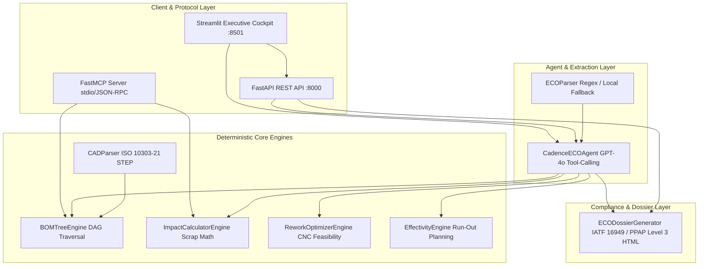

# CadencePLM – System Architecture & Engine Topology (Architecture)
> **Bilingual Technical Architecture Guide / İki Dilli Teknik Mimari Kılavuzu**  
> *English version is presented first, followed by the Turkish version below.*  
> *Önce İngilizce versiyon sunulmuştur; Türkçe versiyon belgenin devamında yer almaktadır.*

---

# [ENGLISH] System Architecture & Engine Topology

CadencePLM is built on a **Deterministic-First, AI-Orchestrated Multi-Tier Architecture** specifically designed for mission-critical industrial manufacturing environments (automotive Tier-1/Tier-2, aerospace, and heavy machinery).

---

## 1. ARCHITECTURAL OVERVIEW & DESIGN PRINCIPLES

### 1.1 The Strict Separation of Concerns (.antigravityrules §1)
The primary architectural principle of CadencePLM is the absolute isolation of **probabilistic reasoning** (Large Language Models) from **deterministic computation** (engineering mathematics, graph traversal, and cost accounting).



- **Deterministic Core (`src/engines/`):** Pure Python, zero-external-network computations. All arithmetic operations, cost multiplications, DAG traversals, and scrap evaluations occur here with 100% mathematical repeatability.
- **Agentic Orchestration (`src/agents/`):** Language models (OpenAI GPT-4o / Google Gemini) act strictly as cognitive routers and natural language synthesizers via function calling (OpenAI Tools).
- **Graceful Degradation:** If internet connectivity drops or external LLM API tokens expire, CadencePLM's deterministic engines, FastAPI endpoints, FastMCP server, and Streamlit cockpit continue operating with zero degradation in analytical precision.

---

## 2. COMPONENT DEEP DIVE

### 2.1 BOMTreeEngine (Graph Topology & Cycle Detection)
- **Data Model:** Directed Acyclic Graph (DAG) represented as in-memory adjacency sets.
- **Top-Down Impact:** Breadth-First Search (BFS) and Depth-First Search (DFS) downwards from any modified part to collect all affected subassemblies and leaf components.
- **Bottom-Up Where-Used:** Ascends parent links from leaf parts to the root assembly ($N$-level depth).
- **Cycle Guard:** Every traversal maintains a `visited_parts` set. If an edge introduces a circular loop ($A \rightarrow B \rightarrow A$), the engine immediately halts and raises `BOMStructureError`.

### 2.2 ReworkOptimizerEngine (Industrial Salvage Heuristics)
- **Feasibility Filter:** Detects whether an affected part is a machinable metal alloy (shaft, pinion, gear, bushing, axle, flange) vs. a non-machinable standard part (seal, bearing, fastener).
- **Economic Formulation:**
  - If change type is `TOLERANCE` or `DIMENSION` on machinable metal:
    - Operation: `CNC_TURNING`
    - Per-unit rework cost: $15\%$ of original unit cost ($0.15 \times \text{unit\_cost}$).
    - Net cash savings: $(\text{unit\_cost} - \text{rework\_cost\_per\_unit}) \times \text{stock\_quantity}$.
  - If change type is `MATERIAL`: Scrap is unavoidable (`is_reworkable = False`).

### 2.3 EffectivityEngine (Run-Out vs. Hard Cut-Off)
- **Depletion Days Formula:**
  $$\text{Run-Out Days} = \left\lceil \frac{\text{Stock Quantity}}{\text{Daily Consumption Rate}} \right\rceil$$
- **Decision Matrix:**
  - $\text{Run-Out Days} \le \text{Tooling Lead Time} \implies \mathbf{USE\_UP\_STOCK}$ (Transition Lead Time = Run-Out Days, Scrap Cost = $0.00).
  - $\text{Run-Out Days} > \text{Tooling Lead Time} \implies \mathbf{IMMEDIATE\_CUTOFF}$ (Transition Lead Time = 0 days, Scrap Cost = $\text{Stock} \times \text{Unit Cost}$).

### 2.4 CADParser (ISO 10303-21 STEP Reader)
- Lightweight ASCII parser implementing STEP AP203/AP214 entity grammar in pure Python.
- Extracts `PRODUCT_DEFINITION`, `PRODUCT_DEFINITION_FORMATION`, and `NEXT_ASSEMBLY_USAGE_OCCURRENCE`.
- Aggregates multi-occurrence component quantities and generates strongly-typed `BOMItem` records.

### 2.5 ECODossierGenerator (IATF 16949 / PPAP Level 3 Reporting)
- Synthesizes simulation outcomes into an executive HTML/CSS document conforming to automotive quality audit standards (Clause 8.5.6).
- Embeds financial trade-off KPI cards, Where-Used visual flow diagrams, supplier die risk matrices, and official tripartite sign-off approval sections.

---

## 3. DATA FLOW & INTEGRATION SURFACES

```
+-------------------------------------------------------------------------------+
|                             DATA FLOW PIPELINE                                |
|                                                                               |
|  [Engineer Text] ──> [ECOParser / LLM] ──> [Structured ECORequest]            |
|                                                       │                       |
|                                                       ▼                       |
|  [STEP AP214 CAD] ──> [CADParser] ─────────> [BOMTreeEngine (DAG)]           |
|                                                       │                       |
|  [SAP Inventory CSV] ─────────────────────────> [SimulationOrchestrator]     |
|                                                       │                       |
|                                   ┌───────────────────┴───────────────────┐   |
|                                   ▼                                       ▼   |
|                       [ReworkOptimizerEngine]                  [Effectivity]  |
|                                   │                                       │   |
|                                   └───────────────────┬───────────────────┘   |
|                                                       ▼                       |
|                                            [SimulationSummary]                |
|                                                       │                       |
|                         ┌─────────────────────────────┼──────────────────┐    |
|                         ▼                             ▼                  ▼    |
|               [FastAPI REST API]            [Streamlit Cockpit]    [FastMCP]  |
|                         │                             │                       |
|                         ▼                             ▼                       |
|                  [JSON Response]             [IATF 16949 Dossier]             |
+-------------------------------------------------------------------------------+
```

---
---

# [TÜRKÇE] Sistem Mimarisi ve Motor Topolojisi

CadencePLM; otomotiv ana ve yan sanayi (Tier-1/Tier-2), havacılık ve ağır makine gibi kritik imalat ortamları için tasarlanmış **Deterministik Öncelikli, Yapay Zeka Destekli Çok Katmanlı Mimari** üzerine kurulmuştur.

---

## 1. MİMARİ GENEL BAKIŞ VE TASARIM PRENSİPLERİ

### 1.1 Sorumlulukların Katı Ayrımı (.antigravityrules §1)
CadencePLM'in temel mimari prensibi, **olasılıksal akıl yürütme** (Büyük Dil Modelleri - LLM) ile **deterministik hesaplama** (mühendislik matematiği, çizge gezintisi ve maliyet muhasebesi) katmanlarının mutlak izolasyonudur.

- **Deterministik Çekirdek (`src/engines/`):** Saf Python ile yazılmış, sıfır dış ağ bağımlılığı olan hesaplama katmanıdır. Tüm dört işlem, maliyet çarpımları, DAG gezintileri ve hurda hesapları %100 matematiksel tekrarlanabilirlikle burada icra edilir.
- **Ajan Tabanlı Orkestrasyon (`src/agents/`):** Dil modelleri (OpenAI GPT-4o / Google Gemini), fonksiyon çağırma (OpenAI Tools) protokolü üzerinden sadece bilişsel yönlendirici ve doğal dil sentezleyicisi olarak çalışır.
- **Hata Toleransı (Graceful Degradation):** İnternet bağlantısı kopsa veya harici LLM API kotası dolsa dahi; CadencePLM deterministik motorları, FastAPI REST servisleri, FastMCP sunucusu ve Streamlit kokpiti analitik kesinliğinden hiçbir şey kaybetmeden çalışmaya devam eder.

---

## 2. ÇEKİRDEK MOTORLARIN TEKNİK İNCELEMESİ

### 2.1 BOMTreeEngine (Çizge Topolojisi ve Döngü Denetimi)
- **Veri Modeli:** Bellek içi komşuluk kümeleriyle modellenen Döngüsel Olmayan Yönlü Çizge (DAG).
- **Aşağı Yönlü Etki:** Değişen parçadan başlayarak etkilenen tüm alt montajları ve yaprak parçaları BFS/DFS ile toplar.
- **Yukarı Yönlü Where-Used:** Yaprak parçadan başlayarak kök montaja kadar üst montaj ilişkilerini ($N$ seviye derinlikte) hiyerarşik olarak çözer.
- **Döngü Güvenliği:** Her gezinti işlemi `visited_parts` kümesini takip eder. Eğer döngüsel bir bağımlılık ($A \rightarrow B \rightarrow A$) oluşursa, sistem sonsuz döngüye girmeden derhal `BOMStructureError` fırlatır.

### 2.2 ReworkOptimizerEngine (Talaşlı İmalat Kurtarma Sezgileri)
- **Fizibilite Filtresi:** Değişen parçanın işlenebilir metal alaşımı (mil, pinyon, dişli, burç, aks, flanş) mı yoksa işlenemez standart parça (conta, rulman, cıvata) mı olduğunu tespit eder.
- **Mali Formülasyon:**
  - İşlenebilir metal üzerinde `TOLERANCE` veya `DIMENSION` değişikliği:
    - Operasyon: `CNC_TURNING` (CNC Torna / Silindirik Taşlama).
    - Parça başı rework maliyeti: Orijinal birim maliyetin %15'i ($0{,}15 \times \text{Birim Maliyet}$).
    - Net nakit tasarrufu: $(\text{Birim Maliyet} - \text{Rework Maliyeti}) \times \text{Stok Miktarı}$.
  - `MATERIAL` değişikliği: Kurtarma imkansızdır, hurda zorunludur (`is_reworkable = False`).

### 2.3 EffectivityEngine (Stok Tüketimi vs. Derhal Kesinti)
- **Stok Tüketim Süresi:**
  $$\text{Run-Out Gün} = \left\lceil \frac{\text{Stok Miktarı}}{\text{Günlük Tüketim Hızı}} \right\rceil$$
- **Karar Mantığı:**
  - $\text{Run-Out Gün} \le \text{Kalıp Teslim Süresi} \implies \mathbf{USE\_UP\_STOCK}$ (Geçiş süresi = Run-Out gün, Hurda = 0.00 $).
  - $\text{Run-Out Gün} > \text{Kalıp Teslim Süresi} \implies \mathbf{IMMEDIATE\_CUTOFF}$ (Geçiş süresi = 0 gün, Hurda = $\text{Stok} \times \text{Birim Maliyet}$).

### 2.4 CADParser (ISO 10303-21 STEP Ayrıştırıcısı)
- Ağır C++ kütüphaneleri gerektirmeyen, saf Python tabanlı ASCII STEP AP203/AP214 ayrıştırıcısıdır.
- `PRODUCT_DEFINITION`, `PRODUCT_DEFINITION_FORMATION` ve `NEXT_ASSEMBLY_USAGE_OCCURRENCE` entity'lerini çözer.
- Çoklu kullanım adetlerini toplar ve güçlü tipli `BOMItem` nesneleri üretir.

### 2.5 ECODossierGenerator (IATF 16949 / PPAP Seviye 3 Raporlama)
- Simülasyon çıktılarını otomotiv kalite standartlarına (Madde 8.5.6) uygun, bağımsız bir HTML/CSS dokümanına dönüştürür.
- Finansal Trade-Off kartları, Where-Used görsel şeması, tedarikçi kalıp risk matrisi ve üçlü resmi onay (Ar-Ge, Satınalma, Kalite) bloklarını içerir.
